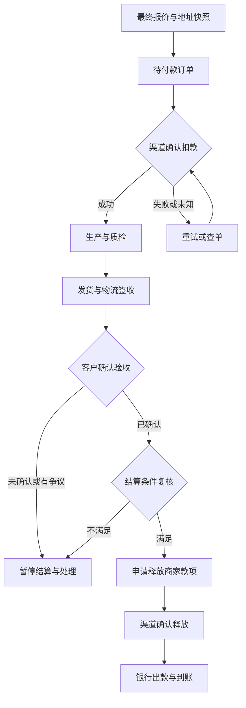

# 共造 · 全球收款与验收后结算设计 v0.4

设计日期：2026-11-08（北京时间）。本文定义下一阶段的支付架构、接入选择和验收条件。**当前项目仍是服务端沙盒，没有开通真实收款、托管、分账、退款或商家提现。** 本文中的接口、状态与账本是实施规格；除已有模拟流程外，不表示已经实现。

产品目标是：客户确认最终报价后付款，平台确认款项收取成功后安排生产；客户明确确认收货验收后，平台才向支付渠道申请释放该笔订单的商家款项。商家账户收到款项和商家银行账户实际到账，是后续两个独立结果。

## 一、必须保持的业务规则

1. 客户选择商家、确认文件版本、工艺、数量、最终金额、币种、交期和收货地址。需要工程审核的询价在最终报价获客户接受前不收款。
2. 地址放在账号资料中；缺失时在测算前弹窗补全。报价关联地址版本；改地址后重新报价。下单保存不可变的报价和收货地址快照，付款过程中不静默改价、换币种或换地址。
3. 只有服务端验证支付成功后才允许进入待排产。浏览器跳回成功页、用户上传付款截图、支付请求返回“受理”，都不能单独触发生产。
4. 物流签收、客户验收、商家结算、银行到账分别记录。物流签收不会自动代表客户确认收货，也不会自动触发放款。
5. 仅在质检通过、物流已送达、客户已明确验收、无有效争议、无处理中退款、款项可用及渠道能力有效时申请商家结算。重复点击不会重复转账。
6. 超过预计交期、验收等待期或渠道持款期限时创建异常工单，不自动替客户验收。无法继续合法合规持款且客户未确认时，在渠道期限前执行约定的取消、退款或其他经批准的处理；不能为了躲避限制，自动把钱付给商家。
7. 通过支付机构批准的平台产品处理收款和结算。平台的订单状态、虚拟余额或“资金冻结”文案本身不构成实际托管能力；不能承诺无限期保管资金。

## 二、客户与商家的页面流程

| 页面 | 客户看到的内容 | 服务端动作 |
| --- | --- | --- |
| 费用测算 | 型号文件、材料、数量；缺地址时弹窗补填 | 验证账号地址，计算费用与交期，生成报价版本 |
| 确认报价 | 制造费用、运费、平台费用、税费适用说明、总金额/币种及收货信息 | 校验报价未过期、地址版本一致、商家仍可履约，短时预留产能 |
| 支付 | 仅列这笔交易实际可用的方法；展示“确认收货后申请商家结算”规则 | 创建一个支付意图，绑定订单、商家、报价快照及支付方式 |
| 待支付结果 | 正在确认 / 支付失败 / 待完成验证 | 验证渠道通知并主动查单补偿，结果未知时保留待确认 |
| 订单详情 | 已付款、生产、质检、物流、确认收货、退款/争议入口 | 按各领域事实更新，不用一个“成功”状态覆盖全部进度 |
| 确认收货 | 确认零件、数量和质量后提交；展示本次结算对象及金额 | 记录买家身份、订单版本、时间和明确确认，再评估结算条件 |
| 商家财务 | 待验收款、结算处理中、渠道已释放、银行处理中、已到账、异常 | 分别读取结算与出款结果；展示金额、扣费、退款和对账明细 |

支付界面使用支付机构的托管收银台或其官方安全组件。平台不自行接收、记录银行卡完整卡号和安全码；银行卡或钱包授权由支付机构完成。不得在演示页面收集真实支付信息。

## 三、全球接入策略

“支持全球主流支付”按支付方法和收款/结算基础设施分开实现。银行卡、Apple Pay、Google Pay 属于客户付款方法；是否能在交付后才释放商家款项，取决于背后的平台收款产品和资金流配置。

| 支付方法或基础设施 | 规划用途 | 当前决策与限制 |
| --- | --- | --- |
| 国际银行卡及 Apple Pay / Google Pay | 国际客户的主要付款入口，交由获准的 PSP 平台产品处理 | 按卡组织、国家、币种、商家资格及客户端能力展示；接入品牌名称不等于所有交易均可用；支付方法支持表作为适配依据 [S8] |
| Stripe Connect | 符合其开户和跨区域规则的实体，可评估收款与商家转账分离 | 优先评估 separate charges and transfers；**仅设置 manual payouts 不能证明尚未把钱释放给商家**，因为它控制账户余额到银行的出款 [S1][S2] |
| Adyen for Platforms | 符合平台与商家入驻条件时，评估多地区支付和平台资金管理 | 必须确认资金记入哪个 balance account、是否已归商家可支配，以及订单级释放机制；不能只延迟银行出款就宣称“商家未收款”；官方支持入驻的国家/地区有范围限制 [S4] |
| PayPal 平台产品 | 国际钱包支付的条件式备选 | delayed disbursement 要求获批合作伙伴及卖家开通相应能力；官方规定捕获款项后会在 28 天自动释放，不能直接满足长期等待客户验收的要求 [S3] |
| 微信支付平台收付通 | 中国交易的优先评估路线，包含电商平台的二级商户进件及冻结/解冻流程 | 需获批该产品并正确设置分账标识；款项进入二级商户账户且处于冻结状态，满足条件后才可解冻和抽佣。它不是平台自有资金账户 [S5] |
| 支付宝平台产品 | 中国交易的候选路线，进一步确认直付通等获批产品 | 评估签约、商家进件、退款与结算能力。官方 SDK 有独立结算/确认结算接口，但本轮未核实适用产品的完整账期规则，须商务确认后启用 [S7] |
| 其他地区本地支付方式 | 后续根据实际客源接入当地银行转账或钱包方式 | 先由可用 PSP 的能力接口返回；逐一验证退款、争议、到账及商家结算能力，未验证时不上线 |

当前尚未确定平台的注册实体、商家所在国家/地区、首发结算币种和签约产品，因此不把某一家渠道设为“全球默认可用”。建议先完成中国或一个获准地区的单市场闭环，再扩展国际收款；一个订单只走一个明确可核对的资金路线。Stripe 的开户地区清单与“可以买单的客户地区”是两回事，不能因客户持国际卡就假设中国大陆注册主体能直接使用 Stripe Connect；先核对实际注册地和获批能力 [S6]。

### 重要的渠道边界

- Stripe 明确表示不提供 escrow 服务或 escrow accounts。其 manual payouts 文档针对相应账户的出款期限：泰国 10 天、美国 2 年、其他国家 90 天。**这些是该功能的出款规则，不是本项目可任意延迟 platform→merchant transfer 的统一承诺。** 实际方案还要单独确认平台账户、商家账户、跨区域转账与获批资金流 [S1][S2]。
- PayPal delayed disbursement 的 28 天自动释放规则与“未确认就不释放”存在冲突。本项目默认禁用该路线；只有合同及运行方案能在截止前处理所有未验收订单，并通过渠道验收后才可启用。付款前的交期评估不能代替付款后的截止日监控；客户不确认、物流延误或争议均可能越过期限 [S3]。
- 微信平台收付通的默认冻结期从支付成功起算为 180 天；期间未发起分账，待分账资金会自动解冻给分账方。官方 FAQ 还说明，发起分账后未分给他方的剩余资金会解冻。因此不能为提前抽取平台佣金而误触发商家余款释放，也不能把这条路线解释为无限等待客户确认。实际延长期限须获批，接近有效截止仍未验收时按异常处理方案提前处置；不能把平台收付通的账期套用到微信普通商户产品 [S5][S9]。
- 延长卡预授权不是“客户已付款并可长期持款”的替代方案。预授权、实际扣款、资金可用、商家释放和银行到账必须分开。不得把 `AUTHORIZED` 当作 `CAPTURED`。
- 结算前后都可能出现渠道争议、拒付或余额调整。客户验收不能被写成客户放弃渠道提供的争议权利；已释放后的追回、退款与准备金处理另有流程。

## 四、状态、数据和资金模型



| 对象 | 建议状态 | 职责 |
| --- | --- | --- |
| `PaymentIntent` | `CREATED / REQUIRES_ACTION / PROCESSING / AUTHORIZED / CAPTURED / FAILED / CANCELLED / UNKNOWN` | 一次明确金额、币种、商家和报价的付款尝试；重试与多次尝试分开 |
| `Order` | `AWAITING_PAYMENT / READY_FOR_PRODUCTION / IN_PRODUCTION / QC_FAILED / READY_TO_SHIP / SHIPPED / DELIVERED / CANCELLED` | 制造与交付状态；不作为现金流事实来源 |
| `Acceptance` | `PENDING / ACCEPTED / CONTESTED` | 记录客户明确验收及证据；不得根据物流自动设为验收 |
| `Refund` | `REQUESTED / REVIEWING / SUBMITTED / SUCCEEDED / FAILED / UNKNOWN` | 全额或部分退款；退款申请不等于钱已退回 |
| `Dispute` | `OPEN / EVIDENCE_REQUIRED / UNDER_REVIEW / RESOLVED / CHARGEBACK` | 平台售后与渠道争议分别标注来源、可结算金额和处理责任 |
| `Settlement` | `NOT_ELIGIBLE / ELIGIBLE / SUBMITTED / SUCCEEDED / FAILED / UNKNOWN / REVERSED` | 本订单释放给商家的分账/转账指令；不代表银行已到账 |
| `Payout` | `NOT_SCHEDULED / PENDING / IN_TRANSIT / PAID / FAILED / RETURNED / UNKNOWN` | 渠道账户到外部银行账户的独立结果 |
| `Ledger` | 只追加分录与冲正分录 | 保存各币种支付、退款、费用、待结算义务、释放和出款的资金事实 |

支付领域需迁到规范化持久表，不能继续用单个 owner 的工作空间 JSON 充当正式账本。至少包括 `payment_intents`、`payment_attempts`、`provider_events`、`refunds`、`disputes`、`settlements`、`payouts`、`ledger_transactions`、`ledger_entries`、`merchant_payment_accounts`、`inbox`、`outbox`。

每笔订单冻结 `buyer_id`、`merchant_id`、`quote_id/version/hash`、模型哈希、制造配置、收货地址快照、金额分项、币种、渠道、商家渠道账号、费用分配规则版本和最晚资金处理日期。地址与联系电话仅给履约所需主体，日志脱敏；渠道密钥不进入前端、订单 metadata 或可下载网关配置。

金额使用整数最小货币单位和渠道币种精度规则，禁止浮点相加。报价币种、客户扣款币种和商家结算币种分字段；换汇需保存报价时间、汇率来源、有效期、费用和实际汇兑差额，未完成多币种对账前不启用自动跨币种结算。

### 账本约束

- 每一账本事务在同一币种下借贷平衡；追加写，纠错用冲正，不直接改历史分录。
- PSP 实际收款、PSP 应收款、未履约客户资金义务、满足验收后的商家应付、平台费用、渠道费用、退款、准备金和出款分别核算。最终会计科目及收入确认由获授权财务人员按合同确认。
- “尚未验收的资金”不得自动变成商家可提现余额，也不得把合并账户总余额直接显示为某商家的订单收益。
- 可释放金额按订单核算，不能超过已确认且可用的款项，扣除成功退款、在途退款预留、争议冻结及按合同承担的费用。部分退款后必须重算并再次确认可结算金额。
- 每个 `provider + merchant_account + provider_payment_id`、`provider_event_id` 和 `settlement_business_key` 设置唯一约束；业务操作与 outbox 同事务提交，渠道返回用 inbox 幂等处理。

## 五、统一支付适配器与接口

`PaymentProvider` 是平台后端的适配层；不是收银台里让用户任意输入的渠道地址。每个适配器只对配置好的官方 API 和账号发送请求。

| 方法 | 输入与结果要点 |
| --- | --- |
| `getCapabilities(context)` | 平台实体、商家国家/账号/资质、买家地区、币种、金额、客户端、预期履约及验收时间；返回可用方法、资金路线、限制和拒绝原因 |
| `createPaymentIntent(orderSnapshot, key)` | 金额由服务端报价快照读取，返回 provider reference 和托管收银台信息；客户端不能覆盖金额或商家账号 |
| `getPayment(reference)` | 主动核对真实状态，处理通知缺失、网络超时与乱序 |
| `verifyWebhook(rawBody, headers)` | 按渠道签名/证书规范验证原始载荷、时间戳与账号上下文；验证失败不改业务状态 |
| `normalizeEvent(verifiedEvent)` | 映射到统一事件，但保存渠道原始事件类型与摘要，未知状态不猜测成功 |
| `requestRefund(payment, amount, key)` | 检查可退款余额、币种、既有退款及结算状态；异步完成后记账 |
| `releaseToMerchant(settlement, key)` | 仅对已通过结算条件的记录调用渠道释放/分账/转账能力，返回受理或最终状态 |
| `getSettlement / getPayout` | 分开查询渠道已释放与银行到账；未知时不得再次创建新指令 |
| `fetchReconciliation(cursor)` | 读取交易、退款、费用、分账、出款账单，匹配账本并建立差异工单 |

规划的公开 API：`GET /payment-methods?orderId=...`、`POST /payment-intents`、`GET /orders/:id/payment`、`POST /refund-requests`、`POST /orders/:id/acceptance`。渠道 webhook 按提供商独立入口。结算及出款接口只供受控后端任务与授权运营使用，客户端无权直接指定“已支付”或“已到账”。这些路径是未来接口约定，不表示当前 `/api/v2` 已提供真实支付能力。

### 通知与网络异常处理

1. 接收 webhook 原始字节，按对应渠道规范验签；确认事件对应本平台、本环境和正确商家账户。测试与正式环境使用不同密钥、库及 webhook 配置。
2. 校验订单关联、渠道支付 ID、金额、币种、商家账号及状态。收到“成功”但金额不符或找不到订单时隔离处理，不安排生产。
3. 验签后先可靠写入事件 inbox；重复事件返回幂等结果。处理失败可以重放，但不能重复记账、生产或结算。
4. 对乱序或矛盾事件使用状态机约束和渠道主动查单。晚到的 `PROCESSING` 不覆盖已确认扣款；晚到的退款/拒付仍必须建立资金处理记录。
5. 创建支付或结算请求超时进入 `UNKNOWN`，复用原业务幂等键查单/重试。不能因前端刷新就换新键再次扣款或转账。
6. 每日及异常触发对账，把渠道与内部账本的金额、费用、退款、释放、出款逐笔核对；发现差异先暂停相关结算并记录待处理事项。

## 六、验收后释放与截止日保护

结算任务在数据库事务内锁定订单及资金记录，重新确认以下全部条件：

```text
payment.capture == confirmed
payment.availableAmount >= settlement.amount
production.qc == passed
logistics.delivery == confirmed
acceptance.buyerConfirmed == true
refund.inFlightAmount == 0
dispute.blockingAmount == 0
merchant.paymentAccount == eligible
settlement.notPreviouslyReleased == true
provider.policyAllowsThisRelease == true
```

检查通过后，创建唯一结算记录及 outbox；渠道确认后才写 `Settlement.SUCCEEDED`。`Acceptance.ACCEPTED` 永远不能直接写成银行到账。生产中取消、返工、货损、拒收、改地址和客诉，由受控售后流程处理，不根据单次按钮点击同时退款并释放原款。

渠道能力记录必须保存：`policyVersion`、`holdStartsAt`、`providerDeadline`、`latestSafeActionAt`、`expectedManufacturingEnd`、`expectedDeliveryEnd`、`acceptanceBuffer`、`refundProcessingBuffer` 与时区。支付前检查最坏履约窗口和处理余量，无法覆盖就不展示该渠道；支付后持续监控，临近截止启动升级告警、暂停新接单和预定异常处理。实际时间来自签约渠道及交易响应，不把任何文档天数写成所有国家通用常量。

客户超时不确认时可以提醒并进入运营处理，但本项目规则不新增“超时默认验收”。若运营调整此规则，必须先更新交易条款和客户界面，不能作为后台隐藏逻辑。需要长期保证“确认才释放”的订单，仅使用明确支持该资金路线且期限覆盖完整生命周期的获批产品。

## 七、落地阶段与验收矩阵

| 阶段 | 交付 | 上线门槛 |
| --- | --- | --- |
| 本轮设计 | 地址与报价关联改造；支付规则说明和本设计；继续保留明确标注的沙盒订单 | 不收真实款，不宣称已接通全球支付 |
| 第一期：一个市场 | 完成平台/商家进件，接入一个获批平台支付产品、一个结算币种 | 测试环境收款、退款、争议、延迟释放、账单对账全部通过 |
| 第二期：小额试点 | 经批准的商家与真实受控订单，收款→履约→买家验收→释放→银行到账 | 取得实际渠道记录和银行到账证据，异常资金可定位，客服和退款流程可执行 |
| 第三期：全球扩展 | 按实体与商家地区增加 PSP、卡/钱包和币种 | 每个新增国家/币种/资金路线单独验收；不把原市场通过视为全球通过 |

| 场景 | 必须验证的结果 |
| --- | --- |
| 报价过期、模型变更、地址修改 | 拒绝继续按旧报价付款，重新确认有效报价 |
| 客户连点付款、回调重复、服务重启 | 一笔有效扣款只记账一次，只安排一次生产 |
| 付款成功页伪造、签名错误、环境/商家账号不符 | 不更新付款成功，不排产 |
| 支付通知金额或币种错误 | 隔离并报警；不静默改订单价 |
| 扣款超时、通知迟到、取消与成功竞态 | 先查明资金事实；重复收款如实际发生进入可追溯退款，不继续重复生产 |
| 物流签收但客户未确认 | 商家款项仍未释放 |
| 质检失败、拒收、未解决争议、在途退款 | 阻断结算；保存处理证据 |
| 客户连点验收、多结算任务并发、渠道响应丢失 | 唯一结算记录；用原键查单/重试，不多次付款 |
| 结算申请受理但银行失败/退回 | 分别显示渠道释放与银行出款状态，不能显示到账成功 |
| 部分退款、费用扣收、换汇差额、结算后拒付 | 每笔金额有账本分录，按币种平衡并匹配渠道账单 |
| 跨买家、跨商家访问付款或结算信息 | 拒绝访问；不能替其他客户确认验收 |
| 预计或实际履约超渠道可持款期限 | 支付前阻断不合适路线；付款后在期限前完成明确异常处置，绝不伪造客户验收 |
| webhook 缺失与账单差异 | 主动补查、可重放、可追溯；差异相关订单暂停结算 |

## 八、与当前沙盒代码的关系

当前 `services/platform/core.mjs` 在创建普通演示订单时直接设置 `SIMULATED_FROZEN` 并模拟排产；`accept` 操作在一次沙盒事务中更新 `SIMULATED_SETTLED` 和 `SIMULATED_RELEASED`。这些值只表达演示结果，没有支付渠道凭据、实际扣款或资金冻结。

真实实现要拆开付款意图、可信扣款通知、生产 outbox、验收记录、结算请求与出款结果。不能仅将上述 `SIMULATED_*` 字符串改成真实名称，或在模拟按钮旁添加支付平台标志，就宣称完成支付接入。当前私人站点及本地 owner 会话还不能代替正式的买家/商家/运营权限隔离和渠道商家审核。

## 官方资料与适用范围

以下资料核验于 2026-11-08。渠道产品、国家覆盖和期限可能调整；签约与上线时重新确认，渠道合同和交易特定规则优先于本设计中的默认选择。产品适配建议是基于这些资料与本项目“验收后释放”的要求作出的工程判断。

- [S1 — Stripe：Using manual payouts](https://docs.stripe.com/connect/manual-payouts)：账户余额到外部银行的出款；国家相关时限；不提供 escrow 服务。
- [S2 — Stripe：Separate charges and transfers](https://docs.stripe.com/connect/separate-charges-and-transfers)：平台收款和向 connected accounts 转账分开，具体账户/国家/跨境能力需按选定集成核实。
- [S3 — PayPal：Delay disbursement](https://developer.paypal.com/platforms/checkout/delayed-disbursement)：合作伙伴与卖家能力要求、`DELAYED` 配置和 28 天自动释放限制。
- [S4 — Adyen：Platforms](https://docs.adyen.com/platforms/)：平台分账、资金管理、出款与支持入驻的国家/地区。
- [S5 — 微信支付：平台收付通产品介绍](https://pay.wechatpay.cn/doc/v3/partner/4012086891)：二级商户、冻结/解冻与默认账期。
- [S6 — Stripe：Global availability](https://stripe.com/global)：平台注册地的可用性清单。
- [S7 — 支付宝官方 Java SDK v3](https://github.com/alipay/alipay-sdk-java-all/blob/master/v3/README.md)：API 集成入口；接口存在不代表该商户已签约或所有账期规则已确认。
- [S8 — Stripe：Payment method support](https://docs.stripe.com/payments/payment-methods/overview)：按地区、币种和产品筛选支付方法。

- [S9 — 微信支付：请求分账](https://pay.wechatpay.cn/doc/v3/partner/4012691594)与[平台收付通常见问题](https://pay.wechatpay.cn/doc/v3/partner/4012525463)：默认冻结期、到期自动解冻及分账剩余资金处理。
